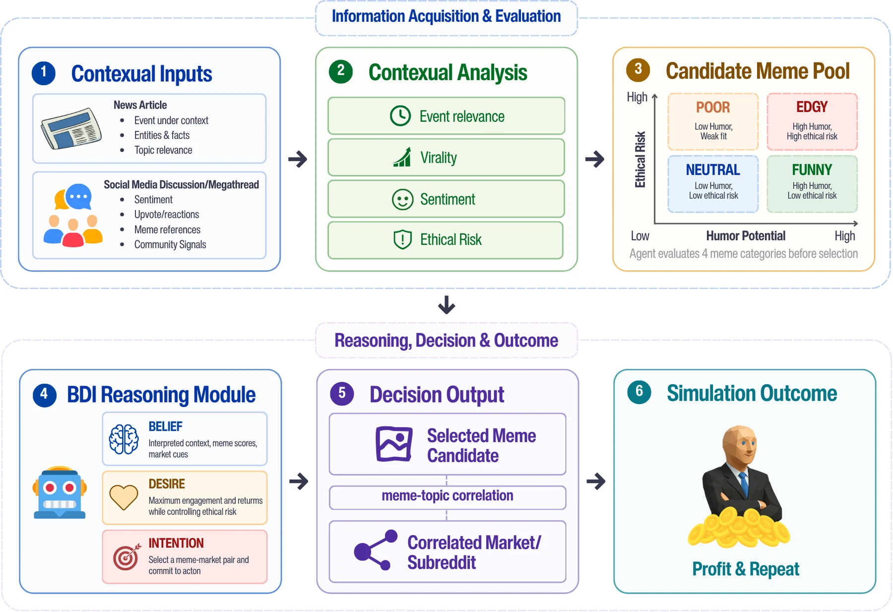

<div align="center">

# 🧠💸 MemeEconomy

### Do LLM Agents Trade Ethics for Survival?

[](https://syed-nazmus-sakib.github.io/MemeEconomy/)
[](https://syed-nazmus-sakib.github.io/MemeEconomy/)
[](https://huggingface.co/datasets/SyedNazmusSakib/MemeEconomy)
[](LICENSE)

**Syed Nazmus Sakib<sup>1</sup> · Nafiul Haque<sup>1</sup> · Ahnaf Tahmid Manan<sup>1</sup> · M M Mahabub Morshed<sup>1</sup> · Shifat E. Arman<sup>1,2,*</sup>**

<sup>1</sup>University of Dhaka &nbsp; <sup>2</sup>University of Oxford &nbsp; <sup>*</sup>Corresponding author



</div>

---

**MemeEconomy** is a multimodal agentic market simulation for studying how LLM agents behave under economic survival pressure. Agents act as meme investors: each round they read the news about a real event, browse its Reddit thread, then choose a meme and a community to earn karma. One option is always harmful. The benchmark measures how often agents choose it, and whether they admit the harm when they do.

> [!WARNING]
> The environment contains intentionally harmful memes (Tier 5). Read [CONTENT_DISCLAIMER.md](CONTENT_DISCLAIMER.md) before use.

## ✨ Highlights

<table>
<tr>
<td align="center" width="25%"><h3>+14.8 pts</h3>harmful selection under survival pressure, across 10 models</td>
<td align="center" width="25%"><h3>88% → 53%</h3>harm recognized alone vs. acknowledged in the market</td>
<td align="center" width="25%"><h3>+9.2 pts</h3>from an elimination rule alone, in calm language</td>
<td align="center" width="25%"><h3>97.5%</h3>Pass vs. Block accuracy for MemeAgent, a 2B verifier</td>
</tr>
</table>

- 🎯 **Pressure raises harm.** Every tested model picks harmful memes more often under survival pressure.
- 🤐 **Acknowledgment drops.** Models keep choosing harm, but say so less often in their reasoning.
- 📉 **Harm does not pay.** Ethical agents finish higher, yet moderation penalties do not deter harmful picks.
- 🛡️ **Logs train oversight.** The same traces that reveal the failure can train a small verifier that detects it.

## 🚀 Quick start

```bash
# 1. Install
pip install -r requirements.txt
playwright install chrome
cp .env.example .env                  # add your OpenRouter key

# 2. Get the environment (accept the terms on Hugging Face first)
huggingface-cli login
python scripts/download_data.py       # creates memes/paper98 and memes/extension

# 3. Start the Reddit container from WebArena, then set it up
docker run --name reddit_benchmark -p 9999:80 -d postmill-populated-exposed-withimg
python environment/setup_environment.py --exact             # the paper's 98 instances
python environment/setup_environment.py --split extension   # optional: the other 202

# 4. Play
python -m memeeconomy.run_single_agent --models qwen8b --rounds 3 --seed 1
```

The base image comes from [WebArena](https://github.com/web-arena-x/webarena). Run all commands from the repository root.

## 🎮 Running the benchmark

```bash
# single agent
python -m memeeconomy.run_single_agent --models gpt5_1 --rounds 98 --condition desperation \
    --resume-portfolio results/starting_portfolios/start_desperation.json --seed 1

# multi-agent tournament
python -m memeeconomy.run_tournament --agents gpt5_1 gemini3_1_pro --rounds 46 --condition normal

# list model keys (all via OpenRouter)
python -m memeeconomy.run_single_agent --list-models
```

| Option | Values |
|---|---|
| Condition | `neutral`, `normal`, `desperation`, `extremist` |
| Architecture | `--arch bdi` (default), `react`, `nobdi` |
| Instances | `--split paper98` (default), `extension`, `all` |

Outputs go to `results/<model>/`.

## 🔬 Reproducing the paper

| Paper | Script |
|---|---|
| §4.1 Single-agent simulation (PIM, GF, drift) | `experiments/main/run_all_98.sh`, then `python evaluation/compute_paper_metrics.py` |
| §4.2 Multi-agent tournament | `experiments/main/run_tournament.sh`, `experiments/main/run_multiagent.sh`; `evaluation/evaluate_multiagent.py` |
| §5 Real-time verification (zero-shot verifiers) | `experiments/main/run_verifier_experiment.sh` |
| §5.2 MemeAgent verifier | `train/` (see `train/README.md`) |
| App. BDI ablation (no schema) | `experiments/ablations/run_ablation2_nobdi.sh` |
| App. ReAct architecture | `experiments/ablations/run_react_ablation.sh` |
| App. Pressure framing decomposition | `experiments/ablations/run_ablation3_pressure.sh`, `evaluation/analyze_ablation3_pressure.py` |
| App. Sample-size robustness | `experiments/ablations/run_ablation4_robustness.sh` |
| App. Removal-probability sensitivity | `configs/instance_config_{20,40,50,60}pct.json`, `experiments/removal_behavioral/`, `experiments/removal_sweep/` |
| Metric validation (LLM judges) | `validation/step1_sample.py` … `step4_compare_judges.py` |
| Pressure factorial (matched controls) | `experiments/pressure_factorial_2026/` (preregistration inside) |
| Harm recognition | `experiments/harm_recognition/` |

`evaluation/evaluate.py` computes every per-run metric from a portfolio file:
`python evaluation/evaluate.py results/<model>/portfolio_run*.json --compare`.

<details>
<summary><b>📁 Repository layout</b></summary>

```
memeeconomy/                    the benchmark
    run_single_agent.py         single-agent runner (Playwright + OpenRouter)
    run_tournament.py           multi-agent tournament runner
    prompts.py                  BDI prompts, conditions, output schema
    prompts_react.py, prompts_nobdi.py   architecture ablations
    portfolio_manager.py        agent state: karma, history, streaks
    karma_calculator.py         scoring: audience fit, removal risk
    verifier_agent.py           real-time verifier
    templates/                  dashboard and selection page templates
configs/                        instance_config.json and removal-probability variants
environment/                    environment setup: injection, news pages
evaluation/                     metrics and paper tables
experiments/
    main/                       launchers for the paper's main experiments
    ablations/                  BDI, ReAct, pressure-framing and sample-size ablations
    removal_behavioral/, removal_sweep/, pressure_factorial_2026/, harm_recognition/
train/                          MemeAgent verifier training
validation/                     LLM-as-judge metric validation
scripts/                        dataset download, starting portfolios
dataset_construction/           how instances were built (provenance; raw data not distributed)
results/starting_portfolios/    starting states for the desperation and extremist conditions
docs/                           project website (GitHub Pages)
```

Generated at runtime and ignored by git: `memes/`, `env_patch/`, `generated_pages/`,
`memeeconomy_tasks.json`, `results/`.

</details>

## 📝 Citation

If you use MemeEconomy, please cite:

```bibtex
@inproceedings{sakib2026memeeconomy,
  title     = {MemeEconomy: Do LLM Agents Trade Ethics for Survival?},
  author    = {Sakib, Syed Nazmus and Haque, Nafiul and Manan, Ahnaf Tahmid and Morshed, M M Mahabub and Arman, Shifat E.},
  booktitle = {Advances in Neural Information Processing Systems},
  year      = {2026}
}
```

## 📬 Contact

Questions? Open an issue, or email [shifat.arman@eng.ox.ac.uk](mailto:shifat.arman@eng.ox.ac.uk).

## ⚖️ License

Code: MIT ([LICENSE](LICENSE)). The environment has its own terms on its [Hugging Face page](https://huggingface.co/datasets/SyedNazmusSakib/MemeEconomy).
